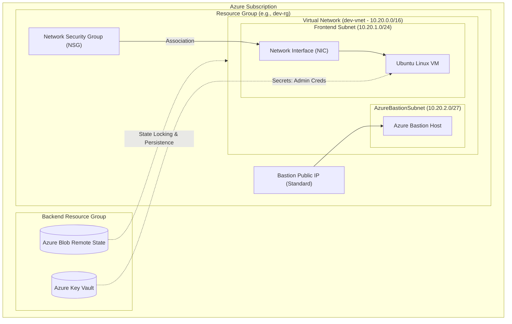
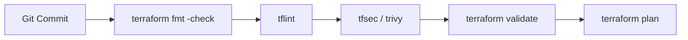

# Azure Reusable Terraform Modules (Enterprise Edition)

[](https://www.terraform.io/)
[](https://registry.terraform.io/providers/hashicorp/azurerm/latest)
[](https://github.com/aquasecurity/tfsec)
[](LICENSE)
[](#)

A modular, highly scalable, and production-ready **Azure Infrastructure as Code (IaC)** framework built with HashiCorp Terraform. This repository implements industry-standard patterns for deploying end-to-end cloud infrastructure including virtual networks, secure subnets, Azure Bastion host, network security groups (NSGs), network interfaces (NICs), Linux virtual machines, and Azure Key Vault secret management.

---

## 📑 Table of Contents

- [Architecture Overview](#-architecture-overview)
- [Repository Structure](#-repository-structure)
- [Module Catalog](#-module-catalog)
- [Prerequisites](#-prerequisites)
- [Remote State Management](#-remote-state-management)
- [Deployment Quickstart](#-deployment-quickstart)
- [Configuration & Variable Schema](#-configuration--variable-schema)
- [Security & Compliance Guidelines](#-security--compliance-guidelines)
- [CI/CD & Code Quality Standards](#-cicd--code-quality-standards)
- [Best Practice Recommendations](#-best-practice-recommendations)
- [Troubleshooting & FAQs](#-troubleshooting--faqs)
- [License](#-license)

---

## 🏛 Architecture Overview

The modules provision a secure, multi-tier Azure landing zone foundation with dedicated management and workload layers:



### Architectural Highlights
1. **Zero Public Ingress to Workloads:** Compute instances reside in private subnets with no direct public IPs.
2. **Secure Management Access:** Administrative access is brokered strictly via **Azure Bastion** using TLS 443 through the Azure Portal.
3. **Layered Defense (Micro-segmentation):** Network Security Groups (NSGs) control ingress and egress at the NIC/Subnet boundary.
4. **Secret Isolation:** Passwords and credentials are managed through **Azure Key Vault** to avoid hardcoded secrets.

---

## 📂 Repository Structure

```text
Azure-Reusable-Terraform-Modules/
│
├── Root Module/                   # Root orchestration module (Environment deployment)
│   ├── Provider.tf                # Provider definitions & azurerm remote backend
│   ├── main.tf                    # Child module invocations and dependency wiring
│   ├── variable.tf                # Variable definitions with input validations
│   └── terraform.tfvars           # Environment-specific configuration values
│
├── azurerm_resource_group/        # Reusable module: Azure Resource Groups
│   ├── main.tf
│   └── variable.tf
│
├── azurerm_virtual_network/       # Reusable module: Azure Virtual Networks (VNets)
│   ├── main.tf
│   └── variable.tf
│
├── azurerm_subnet/                # Reusable module: Subnets
│   ├── main.tf
│   └── variable.tf
│
├── azurerm_bastion/               # Reusable module: Azure Bastion & Public IP
│   ├── main.tf
│   └── variable.tf
│
├── azurerm_NSG/                   # Reusable module: Network Security Groups & Rules
│   ├── main.tf
│   └── variable.tf
│
├── azurerm_network_interface/     # Reusable module: Network Interface Cards (NICs)
│   ├── main.tf
│   └── variable.tf
│
├── azurerm_nsg_nic_association/   # Reusable module: NIC-to-NSG Association
│   ├── main.tf
│   └── variable.tf
│
├── azurerm_linux_vm/              # Reusable module: Azure Linux Virtual Machines
│   ├── main.tf
│   └── variables.tf
│
├── azurerm_key_vault_secret/      # Reusable module: Key Vault Secret provisioning
│   ├── main.tf
│   └── variable.tf
│
├── .gitignore                     # Git ignore rules for Terraform states & secrets
├── LICENSE                        # Project License
└── README.md                      # Production documentation
```

---

## 📦 Module Catalog

| Module | Purpose | Managed Resources / Data Sources |
| :--- | :--- | :--- |
| **`azurerm_resource_group`** | Core lifecycle container | `azurerm_resource_group` |
| **`azurerm_virtual_network`** | Software-defined networking backbone | `azurerm_virtual_network` |
| **`azurerm_subnet`** | IP network partitioning | `azurerm_subnet` |
| **`azurerm_bastion`** | Secure RDP/SSH jump proxy service | `azurerm_public_ip`, `azurerm_bastion_host`, `data.azurerm_subnet` |
| **`azurerm_NSG`** | Stateful firewall rule engine | `azurerm_network_security_group`, `azurerm_network_security_rule` |
| **`azurerm_network_interface`**| Virtual NIC attaching VMs to Subnets | `azurerm_network_interface`, `data.azurerm_subnet` |
| **`azurerm_nsg_nic_association`**| Attaches security perimeter to NIC | `azurerm_network_interface_security_group_association` |
| **`azurerm_linux_vm`** | Compute virtual machine instances | `azurerm_linux_virtual_machine`, `data.azurerm_network_interface` |
| **`azurerm_key_vault_secret`**| Secret storage and injection | `azurerm_key_vault_secret`, `data.azurerm_key_vault` |

---

## ⚙ Prerequisites

Before deploying the infrastructure, verify your environment meets the following specifications:

1. **Terraform CLI**: `>= 1.5.0` ([Download](https://developer.hashicorp.com/terraform/downloads))
2. **Azure CLI**: `>= 2.50.0` ([Install Guide](https://learn.microsoft.com/en-us/cli/azure/install-azure-cli))
3. **Azure Subscription**: Active subscription with `Contributor` and `User Access Administrator` (or `Key Vault Secrets Officer`) roles.
4. **Git**: Installed and configured for version control.

Authenticate with Azure:
```bash
az login
az account set --subscription "<YOUR_SUBSCRIPTION_ID>"
```

---

## 🗄 Remote State Management

The root configuration utilizes the **Azure Blob Storage** remote backend with state locking via native Azure blob leases.

### Required Backend Infrastructure Setup
Execute the following Azure CLI script once to bootstrap the backend container:

```bash
# Variables
BACKEND_RG="backend_pipeline"
LOCATION="centralindia"
STORAGE_NAME="pipelinestorageaccount13"
CONTAINER_NAME="arjun-tfstate"

# 1. Create Resource Group
az group create --name $BACKEND_RG --location $LOCATION

# 2. Create Storage Account (TLS 1.2, Minimum replication)
az storage account create \
  --name $STORAGE_NAME \
  --resource-group $BACKEND_RG \
  --location $LOCATION \
  --sku Standard_LRS \
  --min-tls-version TLS1_2 \
  --allow-blob-public-access false

# 3. Create Blob Container
az storage container create \
  --name $CONTAINER_NAME \
  --account-name $STORAGE_NAME \
  --auth-mode login
```

Ensure the backend block in `Root Module/Provider.tf` matches your storage configuration:

```hcl
terraform {
  backend "azurerm" {
    resource_group_name  = "backend_pipeline"
    storage_account_name = "pipelinestorageaccount13"
    container_name       = "arjun-tfstate"
    key                  = "dev.terraform.tfstate"
  }
}
```

---

## 🚀 Deployment Quickstart

Follow this step-by-step workflow to deploy into an environment:

### Step 1: Clone Repository
```bash
git clone https://github.com/arjunxmishra525/Azure-Reusable-Terraform-Modules.git
cd "Azure-Reusable-Terraform-Modules/Root Module"
```

### Step 2: Initialize Terraform
Downloads provider plugins, modules, and configures the remote backend:
```bash
terraform init
```

### Step 3: Validate and Format
Validate syntax, schema, and ensure canonical formatting:
```bash
terraform fmt -check -recursive
terraform validate
```

### Step 4: Generate Execution Plan
Run an speculative execution plan and output to a binary plan file:
```bash
terraform plan -var-file="terraform.tfvars" -out="tfplan.binary"
```

### Step 5: Review & Apply Plan
Apply the validated execution plan:
```bash
terraform apply "tfplan.binary"
```

### Step 6: Teardown / Destroy (When no longer required)
```bash
terraform destroy -var-file="terraform.tfvars"
```

---

## 📝 Configuration & Variable Schema

### Sample `terraform.tfvars`

```hcl
# Resource Groups
RG = {
  RG1 = {
    name     = "dev-rg"
    location = "Central India"
  }
}

# Virtual Network
vnet = {
  vnet1 = {
    name                = "dev-vnet"
    resource_group_name = "dev-rg"
    location            = "Central India"
    address_space       = ["10.20.0.0/16"]
  }
}

# Subnets
azurerm_subnet = {
  subnet1 = {
    name                 = "Dev-Frontend-Subnet"
    resource_group_name  = "dev-rg"
    virtual_network_name = "dev-vnet"
    address_prefixes     = ["10.20.1.0/24"]
  }
  subnet2 = {
    name                 = "AzureBastionSubnet"
    resource_group_name  = "dev-rg"
    virtual_network_name = "dev-vnet"
    address_prefixes     = ["10.20.2.0/27"]
  }
}

# Bastion Host
bastion = {
  bastion1 = {
    name                  = "consolelogin"
    name_PIP              = "console-pip"
    location              = "Central India"
    resource_group_name   = "dev-rg"
    allocation_method     = "Static"
    sku                   = "Standard"
    name_ip_configuration = "configuration"
    data_subnet           = "AzureBastionSubnet"
    virtual_network_name  = "dev-vnet"
  }
}

# Network Interface
nic = {
  nic1 = {
    name                          = "dev-vm-nic"
    location                      = "Central India"
    resource_group_name           = "dev-rg"
    name_ip_config                = "internal"
    private_ip_address_allocation = "Dynamic"
    data_subnet                   = "Dev-Frontend-Subnet"
    virtual_network_name          = "dev-vnet"
  }
}

# Network Security Group
nsg = {
  nsg1 = {
    name                       = "dev-nsg"
    location                   = "Central India"
    resource_group_name        = "dev-rg"
    name_rule                  = "allow-ssh-inbound"
    priority                   = 100
    direction                  = "Inbound"
    access                     = "Allow"
    protocol                   = "Tcp"
    source_port_range          = "*"
    destination_port_range     = "22"
    source_address_prefix      = "10.20.2.0/27" # Restricted to Bastion subnet
    destination_address_prefix = "10.20.1.0/24"
  }
}

# NSG to NIC Association
nsg_nic = {
  nsg_nic1 = {
    nic_name            = "dev-vm-nic"
    resource_group_name = "dev-rg"
    nsg_name            = "dev-nsg"
  }
}

# Linux Virtual Machine
vm = {
  vm1 = {
    nic_name                        = "dev-vm-nic"
    name                            = "frontendvirtualmachine"
    resource_group_name             = "dev-rg"
    size                            = "Standard_D4_v5"
    location                        = "Central India"
    disable_password_authentication = false
    caching                         = "ReadWrite"
    storage_account_type            = "Standard_LRS"
    publisher                       = "Canonical"
    offer                           = "0001-com-ubuntu-server-jammy"
    source_image_reference_sku      = "22_04-lts"
    version                         = "latest"
  }
}
```

---

## 🔒 Security & Compliance Guidelines

To ensure enterprise-grade security posture across development and production environments:

### 1. Zero Plaintext Secrets in Git
- **DO NOT** commit passwords, tokens, or private keys to `variable.tf` or `terraform.tfvars`.
- Mark credentials with `sensitive = true` in variable blocks.
- Inject secrets via environment variables (`TF_VAR_admin_password`) or dynamically fetch them from **Azure Key Vault** using data blocks.

### 2. Linux Authentication (SSH Keys over Passwords)
- Disable password authentication on all compute nodes (`disable_password_authentication = true`).
- Use ED25519 or RSA (>= 4096-bit) SSH keys:
  ```hcl
  admin_ssh_key {
    username   = var.admin_username
    public_key = file("~/.ssh/id_rsa.pub")
  }
  ```

### 3. Network Hardening & Least Privilege
- **Never allow `0.0.0.0/0` (Any/Any) on SSH port 22 or RDP port 3389.**
- Restrict inbound NSG rules strictly to the `AzureBastionSubnet` CIDR block.
- Enable Azure DDoS Protection and Network Watcher Flow Logs for production workloads.

### 4. Tagging Governance
Enforce standard metadata tags across every deployed resource for cost attribution and compliance:
```hcl
tags = {
  Environment = "dev"
  Owner       = "platform-team"
  ManagedBy   = "Terraform"
  CostCenter  = "CC-1024"
}
```

---

## 🛡 CI/CD & Code Quality Standards

Adopt the automated pipeline stages below before merging pull requests:



### Static Analysis Commands
```bash
# 1. Canonical formatting
terraform fmt -recursive -check

# 2. Linter checking for deprecated syntax and provider rules
tflint --init
tflint

# 3. Security vulnerability and misconfiguration scanning
tfsec .
# OR with Trivy
trivy config .
```

---

## 💡 Best Practice Recommendations

| Area | Current Implementation | Production Standard Recommendation |
| :--- | :--- | :--- |
| **Module Outputs** | Modules do not define outputs | Add `outputs.tf` in each module returning `id`, `name`, `ip_configuration` |
| **Data Source Decoupling** | Downstream modules use `data` lookups by name | Pass resource IDs directly between module outputs to allow Terraform's native DAG resolution |
| **Directory Casing** | Spaces in directory (`Root Module`) and uppercase (`azurerm_NSG`) | Use POSIX snake-case names: `root_module/` or `environments/dev/` and `azurerm_nsg/` |
| **Variable Typing** | `type = map(any)` used in several modules | Explicit typed objects (`map(object({...}))`) with optional attributes for strict validation |
| **NSG Port Mapping** | `destination_port_range` mapped to `destination_address_prefix` | Correct the attribute mapping to `each.value.destination_port_range` |
| **VM Sizing** | Hardcoded `size = "Standard_D4_v5"` in `azurerm_linux_vm/main.tf` | Dynamic assignment using `each.value.size` |

---

## ❓ Troubleshooting & FAQs

### Q1: `Error: Subnet ... does not exist` during NIC or Bastion deployment
**Cause:** Attempting to query the subnet data source before Azure has finished subnet provisioning.  
**Resolution:** Ensure that the subnet module finishes completely by declaring an explicit dependency or passing the subnet ID directly from `module.subnet.subnets[key].id`.

### Q2: Remote Backend State Lock Error
**Cause:** A prior pipeline was aborted or terminated unexpectedly, leaving an active blob lease.  
**Resolution:** Run `terraform force-unlock <LOCK_ID>` after verifying no concurrent execution is active.

### Q3: Key Vault Access Denied (403 Forbidden)
**Cause:** The executing identity (Service Principal or user) does not have Azure RBAC permissions on the Key Vault.  
**Resolution:** Assign the role **Key Vault Secrets Officer** or configure Key Vault Access Policies for your principal.

---

## 📄 License

This project is licensed under the terms of the GNU General Public License v3.0 ([LICENSE](LICENSE)).
