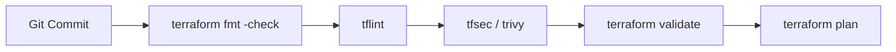

# Azure Reusable Terraform Modules (Enterprise Edition)

[](https://www.terraform.io/)
[](https://registry.terraform.io/providers/hashicorp/azurerm/latest)
[](https://github.com/aquasecurity/tfsec)
[](LICENSE)
[](#)

A modular, highly scalable, and production-ready **Azure Infrastructure as Code (IaC)** framework built with HashiCorp Terraform. This repository implements industry-standard patterns for deploying end-to-end cloud infrastructure including virtual networks, secure subnets, Azure Bastion host, network security groups (NSGs), network interfaces (NICs), Linux virtual machines, Azure Key Vault secret management, and **Azure Public DNS Zones with A Records**.

---

## 📑 Table of Contents

- [Architecture Overview](#-architecture-overview)
- [Repository Structure](#-repository-structure)
- [Module Catalog](#-module-catalog)
- [Prerequisites](#-prerequisites)
- [Remote State Management](#-remote-state-management)
- [Deployment Quickstart](#-deployment-quickstart)
- [Configuration & Variable Schema](#-configuration--variable-schema)
- [Security & Compliance Guidelines](#-security--compliance-guidelines)
- [CI/CD & Code Quality Standards](#-cicd--code-quality-standards)
- [Code Review & Quality Improvements](#-code-review--quality-improvements)
- [Troubleshooting & FAQs](#-troubleshooting--faqs)
- [License](#-license)

---

## 🏛 Architecture Overview

The modules provision a secure, multi-tier Azure landing zone foundation with dedicated management, workload, DNS routing, and secret management layers:

```mermaid
flowchart TD
    subgraph Internet_Clients["Public Internet & Clients"]
        Client["Web Client / Browser"]
    end

    subgraph Public_DNS["Azure Public DNS Management"]
        DNSZone["DNS Zone (b18g103.online)"]
        DNSRecord["DNS A Record (login -> IP)"]
        DNSZone --> DNSRecord
    end

    subgraph Azure_Subscription["Azure Subscription"]
        subgraph RG["Resource Group (e.g., dev-rg)"]
            subgraph VNet["Virtual Network (dev-vnet - 10.20.0.0/16)"]
                subgraph BastionSubnet["AzureBastionSubnet (10.20.2.0/27)"]
                    BastionHost["Azure Bastion Host"]
                end
                subgraph AppSubnet["Frontend Subnet (10.20.1.0/24)"]
                    NIC["Network Interface (NIC)"]
                    VM["Ubuntu Linux VM"]
                    NIC --> VM
                end
            end
            PIP["Bastion Public IP (Standard)"] --> BastionHost
            NSG["Network Security Group (NSG)"] -->|Association| NIC
        end

        subgraph Backend_RG["Backend Resource Group (backend_pipeline)"]
            KV[("Azure Key Vault (pipelinekeyvaultG103)")]
            Storage[("Azure Blob Remote State (pipelinestorageaccount13)")]
        end

        KV -.->|Secrets: Admin Credentials| VM
        Storage -.->|State Locking & Persistence| VNet
    end

    Client -->|Resolve Domain| DNSZone
    Client -.->|Secure Admin Access (HTTPS:443)| BastionHost
    BastionHost -->|Internal SSH (Port 22)| VM
```

### Architectural Highlights
1. **Zero Public Ingress to Workloads:** Compute instances reside in private subnets with no direct public IPs attached to application NICs.
2. **Secure Management Access:** Administrative access is brokered strictly via **Azure Bastion** using TLS 443 through the Azure Portal.
3. **Layered Defense (Micro-segmentation):** Network Security Groups (NSGs) control ingress and egress traffic at the NIC/Subnet boundary.
4. **Secret Isolation:** Passwords and credentials are managed through **Azure Key Vault** to eliminate hardcoded plain-text credentials.
5. **Integrated Public DNS Management:** Manages **Azure Public DNS Zones** and **DNS A Records** with automated input validation for IPv4 formatting and TTL constraints.

---

## 📂 Repository Structure

```text
Azure-Reusable-Terraform-Modules/
│
├── Root Module/                   # Root orchestration module (Environment deployment)
│   ├── Provider.tf                # Consolidated provider definitions & azurerm remote backend
│   ├── main.tf                    # Child module invocations and dependency wiring
│   ├── variable.tf                # Variable definitions with input validations (RG, VNet, DNS)
│   └── terraform.tfvars           # Environment-specific configuration values
│
├── azurerm_resource_group/        # Reusable module: Azure Resource Groups
│   ├── main.tf
│   └── variable.tf
│
├── azurerm_virtual_network/       # Reusable module: Azure Virtual Networks (VNets)
│   ├── main.tf
│   └── variable.tf
│
├── azurerm_subnet/                # Reusable module: Subnets
│   ├── main.tf
│   └── variable.tf
│
├── azurerm_bastion/               # Reusable module: Azure Bastion & Public IP
│   ├── main.tf
│   └── variable.tf
│
├── azurerm_NSG/                   # Reusable module: Network Security Groups & Rules
│   ├── main.tf
│   └── variable.tf
│
├── azurerm_network_interface/     # Reusable module: Network Interface Cards (NICs)
│   ├── main.tf
│   └── variable.tf
│
├── azurerm_nsg_nic_association/   # Reusable module: NIC-to-NSG Association
│   ├── main.tf
│   └── variable.tf
│
├── azurerm_linux_vm/              # Reusable module: Azure Linux Virtual Machines
│   ├── main.tf
│   └── variables.tf
│
├── azurerm_key_vault_secret/      # Reusable module: Key Vault Secret provisioning
│   ├── main.tf
│   └── variable.tf
│
├── azurerm_DNS_ZONE/              # Reusable module: Azure Public DNS Zones
│   ├── main.tf
│   └── variable.tf
│
├── azurerm_DNS_RECORD/            # Reusable module: Azure Public DNS A Records
│   ├── main.tf
│   └── variable.tf
│
├── .gitignore                     # Git ignore rules for Terraform states & secrets
├── LICENSE                        # Project License (GNU GPL v3)
└── README.md                      # Production documentation
```

---

## 📦 Module Catalog

| Module | Purpose | Managed Resources / Data Sources |
| :--- | :--- | :--- |
| **`azurerm_resource_group`** | Core lifecycle container | `azurerm_resource_group` |
| **`azurerm_virtual_network`** | Software-defined networking backbone | `azurerm_virtual_network` |
| **`azurerm_subnet`** | IP network partitioning | `azurerm_subnet` |
| **`azurerm_bastion`** | Secure RDP/SSH jump proxy service | `azurerm_public_ip`, `azurerm_bastion_host`, `data.azurerm_subnet` |
| **`azurerm_NSG`** | Stateful firewall rule engine | `azurerm_network_security_group`, `azurerm_network_security_rule` |
| **`azurerm_network_interface`**| Virtual NIC attaching VMs to Subnets | `azurerm_network_interface`, `data.azurerm_subnet` |
| **`azurerm_nsg_nic_association`**| Attaches security perimeter to NIC | `azurerm_network_interface_security_group_association`, `data.azurerm_network_interface`, `data.azurerm_network_security_group` |
| **`azurerm_linux_vm`** | Compute virtual machine instances | `azurerm_linux_virtual_machine`, `data.azurerm_network_interface` |
| **`azurerm_key_vault_secret`**| Secret storage and injection | `azurerm_key_vault_secret`, `data.azurerm_key_vault` |
| **`azurerm_DNS_ZONE`** | Public DNS zone management | `azurerm_dns_zone` |
| **`azurerm_DNS_RECORD`** | Public DNS A Record mapping | `azurerm_dns_a_record` |

---

## ⚙ Prerequisites

Before deploying the infrastructure, verify your environment meets the following specifications:

1. **Terraform CLI**: `>= 1.5.0` ([Download](https://developer.hashicorp.com/terraform/downloads))
2. **Azure CLI**: `>= 2.50.0` ([Install Guide](https://learn.microsoft.com/en-us/cli/azure/install-azure-cli))
3. **Azure Subscription**: Active subscription with `Contributor` and `User Access Administrator` (or `Key Vault Secrets Officer`) roles.
4. **Git**: Installed and configured for version control.

Authenticate with Azure:
```bash
az login
az account set --subscription "<YOUR_SUBSCRIPTION_ID>"
```

---

## 🗄 Remote State Management

The root configuration utilizes the **Azure Blob Storage** remote backend with state locking via native Azure blob leases.

### Backend Infrastructure Setup
Execute the following Azure CLI script once to bootstrap the backend container:

```bash
# Variables
BACKEND_RG="backend_pipeline"
LOCATION="centralindia"
STORAGE_NAME="pipelinestorageaccount13"
CONTAINER_NAME="arjun-tfstate"

# 1. Create Resource Group
az group create --name $BACKEND_RG --location $LOCATION

# 2. Create Storage Account (TLS 1.2, Minimum replication)
az storage account create \
  --name $STORAGE_NAME \
  --resource-group $BACKEND_RG \
  --location $LOCATION \
  --sku Standard_LRS \
  --min-tls-version TLS1_2 \
  --allow-blob-public-access false

# 3. Create Blob Container
az storage container create \
  --name $CONTAINER_NAME \
  --account-name $STORAGE_NAME \
  --auth-mode login
```

The unified backend block in `Root Module/Provider.tf`:

```hcl
terraform {
  required_version = ">= 1.5.0"
  required_providers {
    azurerm = {
      source  = "hashicorp/azurerm"
      version = "5.10.0"
    }
  }

  backend "azurerm" {
    resource_group_name  = "backend_pipeline"
    storage_account_name = "pipelinestorageaccount13"
    container_name       = "arjun-tfstate"
    key                  = "dev.terraform.tfstate"
  }
}

provider "azurerm" {
  features {}
}
```

---

## 🚀 Deployment Quickstart

Follow this step-by-step workflow to deploy into an environment:

### Step 1: Clone Repository
```bash
git clone https://github.com/arjunxmishra525/Azure-Reusable-Terraform-Modules.git
cd "Azure-Reusable-Terraform-Modules/Root Module"
```

### Step 2: Initialize Terraform
Downloads provider plugins, registers child modules, and configures the remote backend:
```bash
terraform init
```

### Step 3: Validate and Format
Validate syntax, schema, and ensure canonical formatting across all modules:
```bash
terraform fmt -check -recursive
terraform validate
```

### Step 4: Generate Execution Plan
Run an speculative execution plan and output to a binary plan file:
```bash
terraform plan -var-file="terraform.tfvars" -out="tfplan.binary"
```

### Step 5: Review & Apply Plan
Apply the validated execution plan:
```bash
terraform apply "tfplan.binary"
```

### Step 6: Teardown / Destroy (When no longer required)
```bash
terraform destroy -var-file="terraform.tfvars"
```

---

## 📝 Configuration & Variable Schema

### Complete `terraform.tfvars` Reference

```hcl
# Resource Groups
RG = {
  RG1 = {
    name     = "dev-rg"
    location = "Central india"
  }
}

# Virtual Network
vnet = {
  vnet1 = {
    name                = "dev-vnet"
    resource_group_name = "dev-rg"
    location            = "central India"
    address_space       = ["10.20.0.0/16"]
  }
}

# Subnets
azurerm_subnet = {
  subnet1 = {
    name                 = "Dev-Frontend-Subnet"
    resource_group_name  = "dev-rg"
    virtual_network_name = "dev-vnet"
    address_prefixes     = ["10.20.1.0/24"]
  }

  subnet2 = {
    name                 = "AzureBastionSubnet"
    resource_group_name  = "dev-rg"
    virtual_network_name = "dev-vnet"
    address_prefixes     = ["10.20.2.0/27"]
  }
}

# Bastion Host
bastion = {
  bastion1 = {
    name                  = "consolelogin"
    name_PIP              = "console-pip"
    location              = "central India"
    resource_group_name   = "dev-rg"
    allocation_method     = "Static"
    sku                   = "Standard"
    name_ip_configuration = "configuration"
    data_subnet           = "AzureBastionSubnet"
    virtual_network_name  = "dev-vnet"
  }
}

# Network Interface
nic = {
  "nic1" = {
    name                          = "dev-vm-nic"
    location                      = "Central India"
    resource_group_name           = "dev-rg"
    name_ip_config                = "internal"
    private_ip_address_allocation = "Dynamic"
    data_subnet                   = "Dev-Frontend-Subnet"
    virtual_network_name          = "dev-vnet"
  }
}

# Network Security Group & Security Rules
nsg = {
  "nsg1" = {
    name                       = "dev-nsg"
    location                   = "Central India"
    resource_group_name        = "dev-rg"
    name_rule                  = "test123"
    priority                   = 100
    direction                  = "Outbound"
    access                     = "Allow"
    protocol                   = "Tcp"
    source_port_range          = "*"
    destination_port_range     = "*"
    source_address_prefix      = "*"
    destination_address_prefix = "*"
  }
}

# NSG to NIC Association
nsg_nic = {
  nsg_nic1 = {
    nic_name            = "dev-vm-nic"
    resource_group_name = "dev-rg"
    nsg_name            = "dev-nsg"
  }
}

# Linux Virtual Machine
vm = {
  vm1 = {
    nic_name                        = "dev-vm-nic"
    name                            = "frontendvirtualmachine"
    resource_group_name             = "dev-rg"
    size                            = "Standard_D4_v5"
    location                        = "Central India"
    disable_password_authentication = false
    caching                         = "ReadWrite"
    storage_account_type            = "Standard_LRS"
    publisher                       = "Canonical"
    offer                           = "0001-com-ubuntu-server-jammy"
    source_image_reference_sku      = "22_04-lts"
    version                         = "latest"
  }
}

# Azure Key Vault Secrets
key_vault = {
  key_vault_secret1 = {
    name                = "adminusername"
    value               = "arjunfrontendvm"
    key_vault_name      = "pipelinekeyvaultG103"
    resource_group_name = "backend_pipeline"
  }

  key_vault_secret2 = {
    name                = "adminpassword"
    value               = var.admin_password # Supply securely; never hardcode or commit a real password
    key_vault_name      = "pipelinekeyvaultG103"
    resource_group_name = "backend_pipeline"
  }
}

# Azure Public DNS Zone
dns_zone = {
  "dns_zone1" = {
    name                = "b18g103.online"
    resource_group_name = "dev-rg"
  }
}

# Azure Public DNS A Records
dns_record = {
  "record1" = {
    name                = "login"
    zone_name           = "b18g103.online"
    resource_group_name = "dev-rg"
    ttl                 = 3600
    records             = ["203.0.113.10"] # Documentation-only TEST-NET IP; replace with your real public IP.
  }
}
```

### Automated Input Validations

The root module implements Terraform input validation blocks to catch misconfigurations before deployment:

1. **Resource Group Whitelist Validation**:
   - Condition: All RG names must match `dev-rg`, `qa-rg`, or `prod-rg`.
   - Prevents unapproved or non-standard resource group naming conventions.
2. **VNet CIDR Block Validation**:
   - Condition: Address space must strictly equal `["10.20.0.0/16"]`.
3. **DNS A Record TTL Range Validation**:
   - Condition: TTL must be between `30` seconds and `86400` seconds (1 day).
4. **DNS A Record IPv4 Address Validation**:
   - Condition: Evaluates `can(cidrnetmask("${ip}/32"))` for every record to guarantee only valid IPv4 addresses are passed.
5. **DNS Non-Empty String Validation**:
   - Condition: Ensures record name, zone name, and resource group name are not blank or whitespace-only.

---

## 🔒 Security & Compliance Guidelines

To ensure enterprise-grade security posture across development and production environments:

### 1. Zero Plaintext Secrets in Git
- **DO NOT** commit production passwords, tokens, or private keys to `variable.tf` or `terraform.tfvars`.
- Mark credentials with `sensitive = true` in variable blocks.
- Inject secrets via environment variables (`TF_VAR_admin_password`) or dynamically fetch them from **Azure Key Vault** using data blocks.

### 2. Linux Authentication (SSH Keys over Passwords)
- For production, disable password authentication on all compute nodes (`disable_password_authentication = true`).
- Use ED25519 or RSA (>= 4096-bit) SSH keys:
  ```hcl
  admin_ssh_key {
    username   = var.admin_username
    public_key = file("~/.ssh/id_rsa.pub")
  }
  ```

### 3. Network Hardening & Least Privilege
- **Never allow `0.0.0.0/0` (Any/Any) on SSH port 22 or RDP port 3389.**
- Restrict inbound NSG rules strictly to the `AzureBastionSubnet` CIDR block.
- Enable Azure DDoS Protection and Network Watcher Flow Logs for production workloads.

### 4. DNS Zone & Subdomain Protection
- Ensure DNS A records point to active and verified public IP addresses to avoid dangling DNS entries and subdomain takeover risks.
- Enable Azure Resource Locks (`ReadOnly` or `CanNotDelete`) on production DNS zones to prevent accidental deletion.

### 5. Tagging Governance
Enforce standard metadata tags across every deployed resource for cost attribution and compliance:
```hcl
tags = {
  Environment = "dev"
  Owner       = "platform-team"
  ManagedBy   = "Terraform"
  CostCenter  = "CC-1024"
}
```

---

## 🛡 CI/CD & Code Quality Standards

Adopt the automated pipeline stages below before merging pull requests:



### Static Analysis Commands
```bash
# 1. Canonical formatting
terraform fmt -recursive -check

# 2. Syntax and internal consistency validation
terraform validate

# 3. Linter checking for deprecated syntax and provider rules
tflint --init
tflint

# 4. Security vulnerability and misconfiguration scanning
tfsec .
# OR with Trivy
trivy config .
```

### Azure DevOps Pipeline Integration (`azure-pipelines.yml`)

The following is an illustrative pipeline pattern for `dev`, `qa`, and `prod`. Before production use, configure service-connection authentication, environment approvals/checks, separate state keys per environment, and a reviewed plan artifact. Do not use `terraform apply -auto-approve` for production without an enforced approval gate:

```yaml
trigger:
  branches:
    include:
      - main

parameters:
  - name: targetEnvironment
    displayName: 'Target Deployment Environment'
    type: string
    default: 'qa'
    values:
      - 'dev'
      - 'qa'
      - 'prod'

stages:
  - stage: Validate
    displayName: 'Lint & Validation'
    jobs:
      - job: ValidateTerraform
        displayName: 'Format & Validate'
        pool:
          vmImage: 'ubuntu-latest'
        steps:
          - task: TerraformInstaller@1
            inputs:
              terraformVersion: 'latest'
          - script: |
              cd "Root Module"
              terraform init -backend=false
              terraform fmt -check -recursive
              terraform validate
            displayName: 'Validate HCL'

  - stage: Deploy
    displayName: 'Infrastructure Deployment'
    dependsOn: Validate
    jobs:
      - deployment: ApplyInfrastructure
        displayName: 'Apply Infrastructure'
        pool:
          vmImage: 'ubuntu-latest'
        environment: ${{ parameters.targetEnvironment }} # e.g., qa, dev, prod
        strategy:
          runOnce:
            deploy:
              steps:
                - checkout: self
                - task: TerraformInstaller@1
                  inputs:
                    terraformVersion: 'latest'
                - script: |
                    cd "Root Module"
                    terraform init
                    terraform apply -auto-approve -var-file="terraform.tfvars"
                  displayName: 'Terraform Apply'
```

> [!IMPORTANT]
> Azure DevOps requires any environment referenced under `environment: <name>` (such as `qa`) to be pre-created under **Pipelines ➔ Environments** with pipeline permissions enabled before running manual or automated deployments.

---

## 💡 Code Review & Quality Improvements

A comprehensive review of the codebase identified several issues and improvements, which have been addressed:

| Item / Area | Previous Issue | Resolution / Status |
| :--- | :--- | :--- |
| **NSG Port Mapping** | `destination_port_range = each.value.destination_address_prefix` in `azurerm_NSG/main.tf` | **Resolved**: Updated to `each.value.destination_port_range` to prevent port mapping corruption. |
| **VM Sizing** | Hardcoded `size = "Standard_D4_v5"` in `azurerm_linux_vm/main.tf` | **Resolved**: Updated to dynamic lookup `lookup(each.value, "size", "Standard_D4_v5")`. |
| **VM Password Auth** | Hardcoded `disable_password_authentication = false` | **Resolved**: Updated to dynamic lookup `lookup(each.value, "disable_password_authentication", false)`. |
| **DNS Record Data Source / Invalid Index** | A single data source was referenced as `data.azurerm_dns_zone.datadnszone[each.key]`, or a lookup was attempted before a zone created in the same deployment existed. | **Guidance added below**: Use `each.value.zone_name` when the zone is managed by this Terraform deployment; use a `for_each` data source only when looking up pre-existing zones. |
| **Provider Block Structure** | Two separate `terraform { ... }` blocks in `Root Module/Provider.tf` | **Resolved**: Consolidated into a single canonical block with `required_version >= 1.5.0` and backend. |
| **Duplicate Attributes** | Duplicate `resource_group_name = "dev-rg"` in `terraform.tfvars` inside `nsg1` | **Resolved**: Cleaned up duplicated entry in `terraform.tfvars`. |
| **Code Formatting** | Spacing and indentation discrepancies across modules | **Resolved**: Applied `terraform fmt -recursive` across the entire workspace. |
| **Module Catalog & Docs** | Missing `azurerm_DNS_ZONE` and `azurerm_DNS_RECORD` in README | **Resolved**: Added full documentation, Mermaid diagrams, variable schemas, and validations. |
| **Module Outputs** | Modules do not define `outputs.tf` files | **Recommended Next Step**: Introduce `outputs.tf` in all child modules returning IDs, names, and IP configurations. |
| **Direct Resource Chaining** | Downstream modules use `data` lookups by name | **Recommended Next Step**: Pass resource IDs directly between module outputs to utilize Terraform's native DAG resolution. |

---

## ❓ Troubleshooting & FAQs

### Q1: `Error: Subnet ... does not exist` during NIC or Bastion deployment
**Cause:** Attempting to query the subnet data source before Azure has finished subnet provisioning.  
**Resolution:** Ensure that the subnet module finishes completely by declaring an explicit dependency (`depends_on = [module.subnet]`) or passing the subnet ID directly from module outputs.

### Q2: DNS Record Validation Error: `Each DNS A record must contain at least one valid IPv4 address`
**Cause:** One or more values in `var.dns_record.<key>.records` is not a valid IPv4 address or contains invalid characters.  
**Resolution:** Verify that all IP strings are standard IPv4 addresses (e.g. `["49.45.40.50"]`). Do not include CIDR suffixes like `/32` in the records list.

### Q3: DNS A record error: `Invalid index` on `data.azurerm_dns_zone.datadnszone[each.key]`

**Cause:** `data.azurerm_dns_zone.datadnszone` is a single data-source instance, but `[each.key]` treats it as a map. Also, a data source cannot find a DNS zone that is being created in the same apply unless the dependency and lookup design support that workflow.

**Recommended fix when this repository creates the DNS zone:** In `azurerm_DNS_RECORD/main.tf`, remove the DNS-zone data source and use the configured zone name directly:

```hcl
resource "azurerm_dns_a_record" "this" {
  for_each = var.dns_record

  name                = each.value.name
  zone_name           = each.value.zone_name
  resource_group_name = each.value.resource_group_name
  ttl                 = each.value.ttl
  records             = each.value.records
}
```

Ensure the root module passes the same DNS zone name and resource group to the record module, and that the record module depends on the DNS-zone module when both are created in the same deployment:

```hcl
module "dns_record" {
  source = "../azurerm_DNS_RECORD"

  dns_record = var.dns_record

  depends_on = [module.dns_zone]
}
```

The input object must use `zone_name` consistently:

```hcl
dns_record = {
  record1 = {
    name                = "login"
    zone_name           = "b18g103.online"
    resource_group_name = "dev-rg"
    ttl                 = 300
    records             = ["203.0.113.10"] # Documentation-only TEST-NET IP; replace with your real public IP.
  }
}
```

If the DNS zones already exist outside this Terraform deployment and you intentionally need a data source, either use the single data-source address without `[each.key]`, or declare the data source with `for_each = var.dns_record` and configure its `name` and `resource_group_name` from each map entry. Do not mix these two patterns.

### Q4: Remote Backend State Lock Error
**Cause:** A prior pipeline was aborted or terminated unexpectedly, leaving an active blob lease on `dev.terraform.tfstate`.  
**Resolution:** Run `terraform force-unlock <LOCK_ID>` after verifying no concurrent execution is active.

### Q5: Key Vault Access Denied (403 Forbidden)
**Cause:** The executing identity (Service Principal or user) does not have Azure RBAC permissions on the Key Vault.  
**Resolution:** Assign the role **Key Vault Secrets Officer** or configure Key Vault Access Policies for your principal.

### Q6: DNS Resolution Delay
**Cause:** DNS record changes require time to propagate across global DNS resolvers depending on the configured TTL.  
**Resolution:** For testing, use a lower TTL (e.g., `300` seconds) and query the Azure name servers directly:
```bash
nslookup login.b18g103.online <AZURE_NAME_SERVER>
```

### Q7: Azure DevOps Pipeline Error: `Job ApplyInfrastructure: Environment qa could not be found. The environment does not exist or has not been authorized for use.`
**Cause:**
In Azure DevOps YAML pipelines, deployment jobs target an **Environment** resource (e.g., `environment: 'qa'`). This error occurs when:
1. The target environment (e.g., `qa`) has **not been created** in your Azure DevOps project under **Pipelines ➔ Environments**.
2. The environment exists, but the pipeline has not been granted **Pipeline permissions** to deploy into it.

**Step-by-Step Resolution:**

#### 1. Create the Missing Environment in Azure DevOps
1. Open your Azure DevOps Project (`https://dev.azure.com/<OrgName>/<ProjectName>`).
2. In the left navigation menu, go to **Pipelines** ➔ **Environments**.
3. Click **New environment** (or **Create environment**).
4. Enter the Name: **`qa`** (must match case-sensitively with the `environment` parameter in your pipeline YAML).
5. Under **Resource**, select **None** (Terraform deployments manage cloud resources directly and do not require VM/Kubernetes agent pools).
6. Click **Create**.
7. *(Recommended)* Repeat this step to pre-create **`dev`** and **`prod`** environments so future pipeline runs succeed across all stages.

#### 2. Authorize Pipeline Permissions
1. Under **Pipelines** ➔ **Environments**, click the newly created **`qa`** environment to open its dashboard.
2. In the top-right corner, click the **More actions** button (`⋮` or `...`) and select **Security**.
3. Under the **Pipeline permissions** section:
   - Click the **`+` (Add)** button, search for your pipeline name, and click to authorize it.
   - *(Optional)* Alternatively, click the `⋮` next to Pipeline permissions and choose **Open access** to allow all pipelines in the project to target this environment.
4. If your pipeline is currently paused on the run screen with an **"Authorization required"** or **"Permission needed"** banner, click **View** ➔ **Permit** / **Authorize**.

#### 3. Re-run the Pipeline
1. Return to **Pipelines** ➔ Select your pipeline ➔ Click **Run pipeline**.
2. The `ApplyInfrastructure` job will now successfully locate the `qa` environment and proceed with deployment.

---

## 📄 License

This project is licensed under the terms of the GNU General Public License v3.0 ([LICENSE](LICENSE)).
