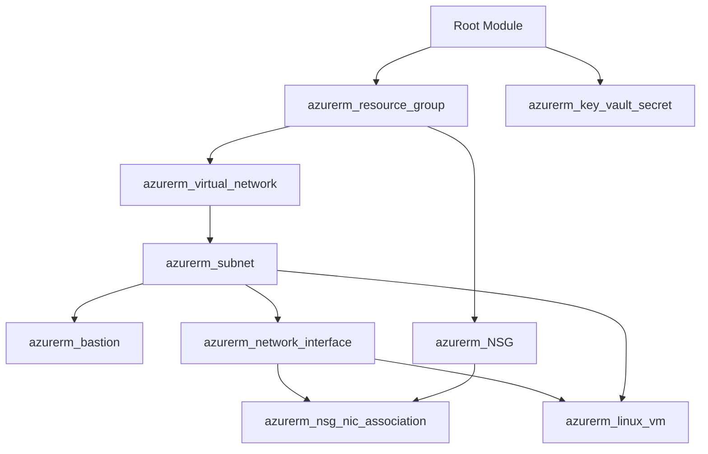

# Root Orchestration Module

This directory contains the root orchestration configuration that coordinates and provisions resources across all reusable Azure child modules.

## Architecture & Module Flow



## Usage

### 1. Configure Backend & Providers
Verify [Provider.tf](Provider.tf) points to your remote storage account and container:
```hcl
terraform {
  required_version = ">= 1.5.0"
  required_providers {
    azurerm = {
      source  = "hashicorp/azurerm"
      version = "~> 4.0"
    }
  }
  backend "azurerm" {
    resource_group_name  = "backend_pipeline"
    storage_account_name = "pipelinestorageaccount13"
    container_name       = "arjun-tfstate"
    key                  = "dev.terraform.tfstate"
  }
}
```

### 2. Configure Variables
Create or customize [terraform.tfvars](terraform.tfvars).

### 3. Deploy
```bash
terraform init
terraform fmt -check
terraform validate
terraform plan -out=tfplan.binary
terraform apply tfplan.binary
```

For full documentation, architecture diagrams, and security specifications, see the parent [Project README](../README.md).
